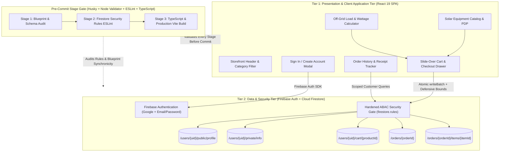

# Helios Solar Direct — Two-Tier E-Commerce Architecture & Pre-Commit Pipeline

## 1. Two-Tier System Architecture

Helios Solar Direct implements a strict **Two-Tier Client–Data Architecture**:

- **Tier 1 — Presentation & Client Application Tier (React 19 + TypeScript + Tailwind CSS)**
  - Renders the solar hardware storefront across five core equipment categories: **Solar Generators**, **Solar Batteries**, **Solar Panels**, **Solar Rechargeable Fans**, and **Solar Inverters**.
  - Executes client-side catalog search, category filtering, off-grid solar load & wattage sizing calculations, shopping cart state management, and defensive payload validation synced verbatim with `firebase-blueprint.json`.
  - Handles user authentication (**Sign Up / Create Account** and **Sign In** via Google OAuth Popup and Firebase Email/Password Authentication).

- **Tier 2 — Data & Authentication Tier (Firebase Authentication + Cloud Firestore Enterprise)**
  - Enforces Zero-Trust Attribute-Based Access Control (ABAC) directly at the database boundary via `firestore.rules`.
  - Isolates customer PII (`UserPrivateInfo`) from public identity records (`UserPublicProfile`) using the Split Collection pattern.
  - Persists per-user shopping carts (`/users/{userId}/cart/{productId}`) and atomic transactional orders (`/orders/{orderId}` + `/orders/{orderId}/items/{itemId}`).

---

## 2. Multi-Stage Pre-Commit Check Pipeline

Every stage of the codebase passes through `scripts/precommit.mjs` (invoked automatically by `.husky/pre-commit` and `npm run precommit`):

1. **Stage 1 — Architecture & Schema Integrity (`--stage=1`)**
   - Verifies `ARCHITECTURE.md`, `firebase-blueprint.json`, and `security_spec.md` exist and parse cleanly.
   - Confirms strict JSON Schema Draft-07 adherence in `firebase-blueprint.json` with zero unauthorized schema keys.
2. **Stage 2 — Security Rules Static Analysis & Synchronicity (`--stage=2`)**
   - Runs `@firebase/eslint-plugin-security-rules` against `firestore.rules`.
   - Verifies default-deny catch-all, `email_verified == true` enforcement, PII split-collection isolation, and blueprint `maxLength` synchronicity.
3. **Stage 3 — TypeScript Typecheck & Frontend Integrity (`--stage=3`)**
   - Executes `tsc --noEmit` across all TypeScript modules.
   - Verifies generated solar hardware studio assets exist on disk and confirms zero forbidden browser dialogs (`window.alert`).
